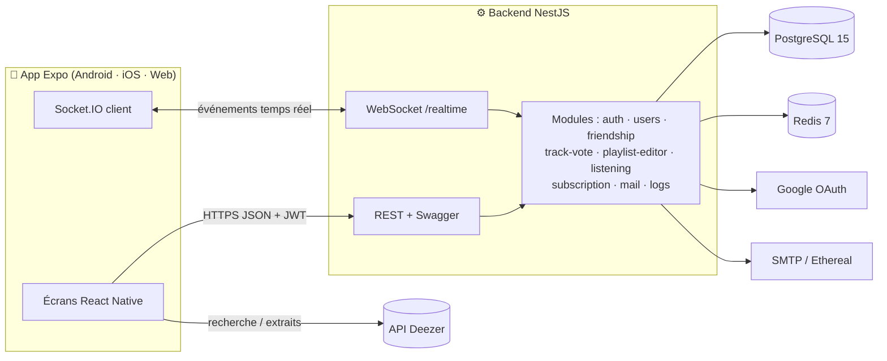

<div align="center">

# 🎵 Music Room

**Application mobile collaborative pour écouter, voter et construire des playlists à plusieurs, en temps réel.**

[](https://github.com/Biaroun/Music-Room/actions/workflows/ci.yml)
[](https://github.com/Biaroun/Music-Room/tags)


[Fonctionnalités](#-fonctionnalités) •
[Architecture](#-architecture) •
[Démarrage rapide](#-démarrage-rapide) •
[API](#-api) •
[Sécurité](#-sécurité) •
[Tests & CI](#-qualité-tests-et-ci) •
[Performances](#-performances)

</div>

---

## 📖 À propos

**Music Room** est un projet de l'école 42 : une application mobile (Android, iOS et web) adossée à une API NestJS, qui permet à un groupe de personnes de **décider ensemble de la musique**.

Deux services sont implémentés (le sujet en demande 2 sur 3) :

| Service | En bref |
|---|---|
| 🗳️ **Music Track Vote** | Une file de morceaux par événement. Chacun propose des titres et vote ; les plus votés remontent et passent en premier. |
| 📝 **Music Playlist Editor** | Édition d'une playlist à plusieurs, en direct, avec gestion des conflits d'édition. |

La recherche de morceaux et les extraits audio s'appuient sur l'API publique **Deezer**.

## ✨ Fonctionnalités

**Comptes et social**
- Inscription par e-mail / mot de passe avec **validation par mail**, mot de passe oublié
- Connexion et **liaison de compte Google** (OAuth 2.0 + PKCE)
- Profil avec **visibilité par champ** (public, amis, privé) et goûts musicaux
- **Système d'amis** : demandes, acceptation, refus, blocage, et « ce que mes amis écoutent » en direct

**Track Vote**
- Événements **publics ou privés**, avec invitations
- Trois licences de vote : `open`, `invite-only`, `geo-time-restricted` (zone géographique + plage horaire)
- Import d'une playlist existante dans la file d'un événement
- Classement recalculé côté serveur et diffusé à tous les participants

**Playlist Editor**
- Playlists **publiques ou privées**, édition `open` ou `invite-only`, collaborateurs
- Ajout, suppression et réordonnancement en temps réel (une room Socket.IO par playlist)
- **Contrôle de concurrence optimiste** : versionnage de la playlist, rejet des modifications périmées (`playlist:conflict`)

**Bonus**
- 🌐 **Web responsive** : la même app Expo tourne dans le navigateur
- 💎 **Abonnement Free / Premium** (sans paiement) : seuls les comptes Premium créent des événements, vérifié côté serveur

## 🏗 Architecture



| Couche | Choix | Pourquoi |
|---|---|---|
| Backend | **NestJS 11** (TypeScript) | Architecture modulaire, injection de dépendances, Swagger généré depuis les décorateurs |
| Base de données | **PostgreSQL 15** + TypeORM | Données relationnelles et contraintes d'unicité, sur lesquelles repose la gestion des votes simultanés |
| Cache / état éphémère | **Redis 7** | Liste noire des JWT révoqués, morceau en cours d'écoute |
| Temps réel | **Socket.IO** | Diffusion des votes et des modifications de playlist sans polling |
| Mobile | **React Native 0.85 / Expo 56** | Un seul code pour Android, iOS et le web |

### Structure du dépôt

```
Music-Room/
├── backend/                 # API NestJS
│   ├── src/
│   │   ├── auth/            # JWT, Google OAuth, validation mail, reset password
│   │   ├── users/           # profils et visibilité des champs
│   │   ├── friendship/      # amis, demandes, blocage
│   │   ├── track-vote/      # événements, votes, licences, géo-restriction
│   │   ├── playlist-editor/ # playlists collaboratives temps réel
│   │   ├── listening/       # « en écoute » partagé avec les amis
│   │   ├── subscription/    # offres Free / Premium
│   │   ├── mail/            # envoi des mails (Ethereal ou SMTP)
│   │   └── logs/            # journal de chaque requête HTTP / WS
│   ├── test/                # tests e2e
│   └── requests/            # requêtes .http prêtes à l'emploi
├── mobile/                  # App Expo (screens, components, context, lib)
├── scripts/                 # setup .env, comptes de test, tests de charge
├── docs/                    # montée en charge, sécurité, specs de conception
├── docker-compose.yml       # Postgres + Redis
└── Makefile                 # point d'entrée de toutes les commandes
```

## 🚀 Démarrage rapide

### Prérequis

- [Node.js 24](https://nodejs.org/) et npm (voir [`.nvmrc`](.nvmrc))
- [Docker](https://www.docker.com/) + Docker Compose
- Un émulateur Android, un simulateur iOS ou un navigateur

### Installation

```bash
git clone https://github.com/Biaroun/Music-Room.git
cd Music-Room
make install   # crée les .env depuis les modèles puis installe backend + mobile
make start     # Postgres + Redis (Docker), backend et Expo
```

| Commande | Effet |
|---|---|
| `make docker-up` / `make docker-down` | Démarre / arrête Postgres (port `5433`) et Redis (port `6380`) |
| `make dev-back` | Backend en mode watch sur http://localhost:3000 |
| `make dev-mobile` | Expo pour Android / iOS |
| `make dev-web` | Expo dans le navigateur |
| `make seed-users` | Crée 3 comptes de test vérifiés et amis (`seed_alice`, `seed_bob`, `seed_carol`) |
| `make check` | Types, build, tests unitaires et e2e (identique à la CI) |
| `make stop` | Arrête tout |

> Les mots de passe des comptes de test sont générés aléatoirement et écrits dans `backend/.env.seed-users` (ignoré par git).

### Configuration

`make install` copie [`backend/.env.exemple`](backend/.env.exemple) vers `backend/.env`. Aucun secret n'est commité.

| Variable | Rôle |
|---|---|
| `DATABASE_URL`, `REDIS_URL` | Déjà alignées sur `docker-compose.yml` |
| `JWT_SECRET`, `JWT_EXPIRES_IN` | Signature et durée de vie des tokens (**à changer**) |
| `GOOGLE_CLIENT_ID_*`, `GOOGLE_CLIENT_SECRET_WEB`, `GOOGLE_CALLBACK_URL_WEB` | Connexion Google (Google Cloud Console) |
| `OAUTH_APP_REDIRECT` | Adresses de retour autorisées après Google (`http://localhost:8082,musicroom://,exp://`) |
| `MAIL_HOST`, `MAIL_PORT`, `MAIL_USER`, `MAIL_PASSWORD`, `MAIL_FROM` | Envoi des mails |
| `THROTTLE_TTL_MS`, `THROTTLE_LIMIT`, `THROTTLE_ALLOWLIST` | Limitation de débit par IP |

<details>
<summary><b>📧 Mails en développement (Ethereal)</b></summary>

Par défaut (`MAIL_HOST=ethereal`), les mails passent par [Ethereal](https://ethereal.email), un faux serveur SMTP. Rien n'arrive dans une vraie boîte : le backend affiche dans ses logs un **lien de prévisualisation** pour chaque mail (validation de compte, reset de mot de passe).

- Avec `MAIL_USER` / `MAIL_PASSWORD`, la boîte est fixe et consultable sur [ethereal.email/login](https://ethereal.email/login).
- Sans, une boîte jetable est créée à chaque démarrage.
- Pour un vrai fournisseur (Brevo, etc.), renseigner les variables `MAIL_*`.

</details>

<details>
<summary><b>📱 Adresse du backend depuis l'app</b></summary>

L'adresse de l'API se change **dans l'application**, via l'écran **Server** accessible depuis la connexion. L'app vérifie qu'il s'agit bien de l'API Music Room avant de l'enregistrer.

| Contexte | Adresse |
|---|---|
| Émulateur Android | `http://10.0.2.2:3000` (défaut) |
| Navigateur / simulateur iOS | `http://localhost:3000` |
| Téléphone physique (même Wi-Fi) | `http://<IP_DE_LA_MACHINE>:3000` |

La valeur par défaut peut être fixée au build avec `EXPO_PUBLIC_API_URL` dans `mobile/.env`. Si le port 3000 est pris, le backend bascule sur le suivant.

</details>

<details>
<summary><b>🔑 Connexion Google sur mobile</b></summary>

Google renvoie toujours sur `GOOGLE_CALLBACK_URL_WEB` (`http://localhost:3000/...`). Sur émulateur Android ou téléphone en USB, `make start` / `make dev-mobile` lancent `adb reverse tcp:3000 tcp:3000` (relançable avec `make android-reverse`). Sur un téléphone physique sans câble, il faut une URL publique HTTPS (tunnel type ngrok) déclarée dans la console Google. Sous Expo Go, `OAUTH_APP_REDIRECT` doit contenir `exp://`.

</details>

## 📡 API

La documentation **Swagger / OpenAPI** est générée automatiquement depuis le code :

- Interface : **http://localhost:3000/api/docs**
- JSON OpenAPI : http://localhost:3000/api/docs-json

Des requêtes prêtes à l'emploi sont disponibles dans [`backend/requests/`](backend/requests) (format `.http`, VS Code REST Client / JetBrains).

### REST

| Ressource | Routes principales |
|---|---|
| `/auth` | `register`, `login`, `logout`, `verify-email`, `resend-verification`, `forgot-password`, `reset-password`, `google/web`, `google/exchange`, `google/mobile`, `google/link` |
| `/users` | `GET /me`, `PATCH /me`, `PATCH /me/email`, `PATCH /me/password`, `GET /search`, `GET /:id` |
| `/friendship` | demandes (`request/:id`, `:id/accept`, `:id/reject`), blocage, `friends`, `pending`, `blocked` |
| `/track-vote/events` | CRUD des événements, invitations |
| `/track-vote/events/:id` | `board`, `tracks`, `import-playlist`, `vote` |
| `/playlist-editor` | CRUD des playlists, `tracks`, `tracks/reorder`, `collaborators` |
| `/listening` | `PUT /me`, `DELETE /me`, `GET /friends` |
| `/subscription` | `subscribe`, `cancel` |

### Temps réel (Socket.IO, namespace `/realtime`)

| Client → serveur | Serveur → client |
|---|---|
| `event:join`, `event:leave`, `vote:cast`, `vote:retract` | `vote:board`, `vote:error` |
| `playlist:join`, `playlist:leave`, `playlist:track:add`, `playlist:track:remove`, `playlist:reorder` | `playlist:state`, `playlist:conflict`, `playlist:error` |
| `listening:update`, `listening:stop` | `listening:snapshot`, `listening:changed`, `listening:stopped` |

**Pourquoi REST + WebSocket ?** REST s'appuie sur les verbes et codes HTTP standard : l'API est lisible, simple à documenter et à tester. Le temps réel passe par WebSocket, sinon le client devrait interroger le serveur en boucle.

### Gestion de la concurrence

- **Votes** : un vote est une ligne unique `(événement, votant, morceau)` insérée avec `INSERT … ON CONFLICT DO NOTHING`. Deux votes simultanés ne peuvent ni se dupliquer ni s'écraser.
- **Playlists** : chaque playlist porte un numéro de version incrémenté à chaque modification. Un réordonnancement envoyé sur une version périmée est refusé et seul son auteur reçoit l'état à jour.

## 🔒 Sécurité

| Risque | Protection |
|---|---|
| Accès aux données d'autrui | Routes protégées par JWT, contrôle propriétaire / invité / ami à chaque accès, visibilité des champs de profil respectée |
| Bruteforce | Rate limiting par IP (300 req/min global, bien plus strict sur l'authentification), vérifié en e2e (`429` après 5 échecs) |
| Vol de session | JWT à durée limitée, mis en **liste noire Redis** à la déconnexion (HTTP et WebSocket) |
| Mots de passe | Hachés avec **bcrypt**, jamais renvoyés par l'API |
| Injection / champs inattendus | `ValidationPipe` en mode `whitelist`, requêtes paramétrées via TypeORM |
| OAuth | Redirections en liste blanche, code à usage unique d'une minute échangé avec un vérificateur **PKCE**, le JWT ne passe jamais dans une URL |
| Comptes non vérifiés | Bloqués sur les routes protégées tant que l'e-mail n'est pas validé |
| Secrets | Uniquement dans des `.env` ignorés par git |

Chaque action (HTTP comme WebSocket) est journalisée dans la table `log` avec la plateforme, l'appareil et la version de l'app (en-têtes `x-client-*`), l'utilisateur, le statut, la durée et l'IP :

```bash
docker compose exec postgres psql -U postgres -d musicroom \
  -c 'SELECT action, platform, device, "appVersion", "statusCode", "createdAt" FROM log ORDER BY id DESC LIMIT 20;'
```

Plus de détails dans [`docs/securite.md`](docs/securite.md).

## ✅ Qualité, tests et CI

```bash
make docker-up
make check   # backend : types + build + tests unitaires + e2e · mobile : types
```

La [CI GitHub Actions](.github/workflows/ci.yml) exécute exactement la même chose à chaque push, avec un vrai PostgreSQL et un vrai Redis.

## 📈 Performances

Campagne de montée en charge reproductible, méthode et résultats complets dans [`docs/ramp-up.md`](docs/ramp-up.md).

> **600 utilisateurs simultanés · ~1 500 req/s · 0 % d'erreur** sur un seul processus Node (i9-13900H, 32 Go).

```bash
make load-seed   # crée le pool de comptes
make load-test   # campagne par paliers, en Node, sans dépendance
```

## 🗺 Correspondance avec le sujet

| Section | État |
|---|---|
| V.1 Utilisateur (inscription, Google, validation mail, profil, amis) | ✅ |
| V.2.1 Music Track Vote | ✅ |
| V.2.2 Music Control Delegation | ➖ Non retenu (2 services sur 3 demandés) |
| V.2.3 Music Playlist Editor | ✅ |
| V.3 Serveur de référence | ✅ |
| V.4 Documentation de l'API | ✅ Swagger |
| V.5 Adresse du backend réglable | ✅ |
| V.6 Sécurité et logs | ✅ |
| V.7 Montée en charge | ✅ |
| V.8 Qualité et CI | ✅ |
| VI.1 Multi-plateforme (web responsive) | ✅ Bonus |
| VI.2 IoT / iBeacon | ❌ |
| VI.3 Abonnement Free / Premium | ✅ Bonus |
| VI.4 Mode hors ligne | ❌ |

## 🤝 Contribuer

Voir [CONTRIBUTING.md](CONTRIBUTING.md) pour les conventions de branches, de commits et le workflow de PR. L'historique des versions est dans [CHANGELOG.md](CHANGELOG.md).

## 👥 Auteurs

| | |
|---|---|
| **Bilal Aroun** | [@Biaroun](https://github.com/Biaroun) |
| **Thomas Benelgorch** | [@Neo677](https://github.com/Neo677) |

---

<div align="center">
<sub>Projet réalisé dans le cadre du cursus <b>42</b>.</sub>
</div>
